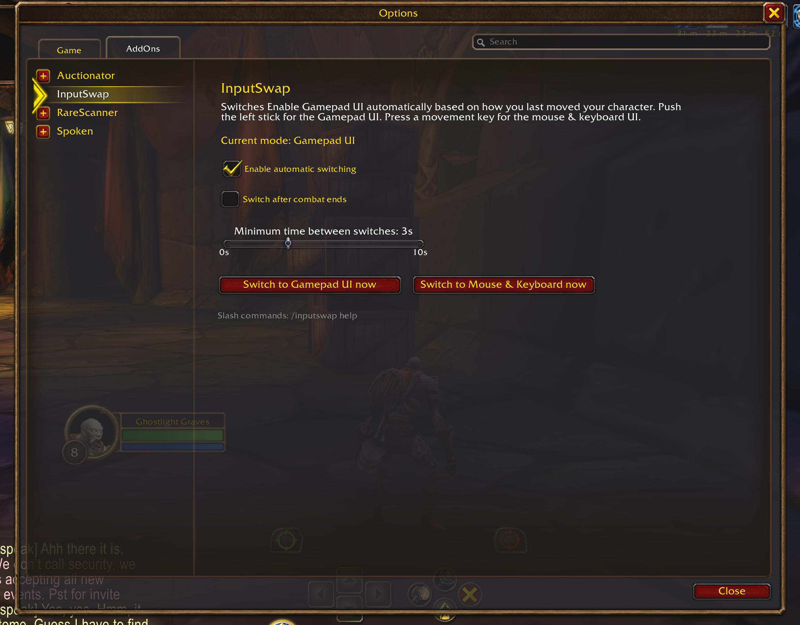

# InputSwap

Automatically switches **Enable Gamepad UI (Beta)** on and off in **World of Warcraft: Forever**, depending on how you last moved your character.

- Push the **left analog stick** and the Gamepad UI turns on.
- Press a **movement key** (WASD, or whatever you have bound) and the regular mouse and keyboard UI comes back.

No more digging through the menu every time you put the controller down or pick it up.



## Requirements

- World of Warcraft: Forever (interface `16001`).
- A controller that WoW sees as a gamepad. If you use Steam, launch WoW through Steam and use a **Gamepad** layout, not a keyboard-and-mouse one. Otherwise WoW only sees keyboard and mouse input and InputSwap has nothing to detect.
- **GamePadEnable** turned on (`/console GamePadEnable 1`). This is what lets WoW send stick input to addons. InputSwap does not change it.

## Install

**WoWUp:** Add a new addon from URL and paste `https://github.com/bknie1/InputSwap`.

**Manual:** Download the latest `InputSwap-vX.Y.Z.zip` from [Releases](https://github.com/bknie1/InputSwap/releases) and extract it into
`World of Warcraft\_forever_\Interface\AddOns\` so you end up with `AddOns\InputSwap\InputSwap.toc`.

## Options

Open **Options > AddOns > InputSwap** (or type `/inputswap config`):

| Option | What it does |
| --- | --- |
| Enable automatic switching | Turns the addon on or off. |
| Switch after combat ends | Off (default): stick and key input is ignored during combat. On: the last input during combat is remembered and applied when combat ends. |
| Minimum time between switches | Default 3 seconds. Each switch reloads the UI, so this stops a bump of the stick from causing repeated loading screens. |
| Show minimap button | A minimap icon showing the current mode (controller or keyboard). Left-click switches now, right-click opens these options, drag to move it. |
| Switch ... now | Buttons to switch immediately. |

## Commands

```
/inputswap              show status
/inputswap on | off     enable or disable
/inputswap pad | mkb    switch to Gamepad UI / mouse & keyboard UI right now
/inputswap combat       toggle: ignore input in combat, or switch once combat ends
/inputswap delay <s>    minimum seconds between switches
/inputswap minimap      show or hide the minimap button
/inputswap config       open the options panel
/inputswap debug        toggle debug messages
/inputswap debug raw    log every key and stick event (useful if something is not detected)
/inputswap debug keys   list the movement keys InputSwap is watching
/inputswap debug cvar   show or change the CVar being controlled
/inputswap help         list all commands
```

`/is` works as a shorthand for `/inputswap`.

## How it works

The **Enable Gamepad UI (Beta)** menu option is backed by the `InputDeviceInterfaceStyle` CVar (`0` = mouse and keyboard, `1` = gamepad). InputSwap watches the left stick and your bound movement keys and sets that CVar when the last-used input changes.

Only movement counts. Other controller buttons, the right stick, triggers, and mouse input are ignored on purpose, so menu bindings on your triggers or shoulder buttons never cause a switch.

## Limitations

- Changing the Gamepad UI setting reloads the interface behind a loading screen. That is WoW's behavior, not something an addon can avoid.
- WoW does not let addons change this setting during combat. By default InputSwap ignores input in combat; the combat option queues it until combat ends.
- Gyro aiming exposed by Steam Input as mouse movement is ignored, because it cannot be told apart from a real mouse.

## Troubleshooting

- **Nothing happens when I push the stick:** run `/inputswap debug raw` and push it. If no `stick` line appears, WoW is not receiving gamepad input (check `GamePadEnable` and your Steam layout). If a line appears with a stick name that is not "Left", open an issue with that name.
- **WASD does nothing:** run `/inputswap debug keys` to see which keys are being watched.

## License

[MIT](LICENSE)
